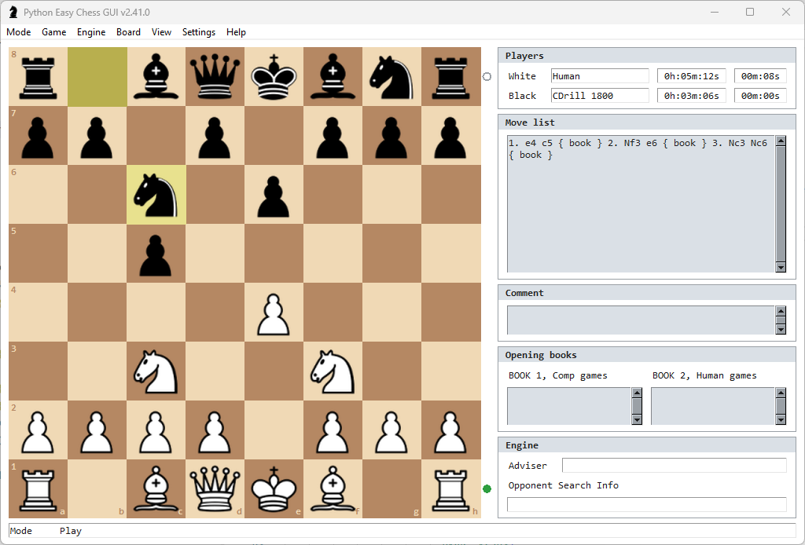
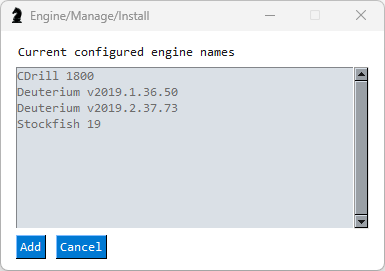
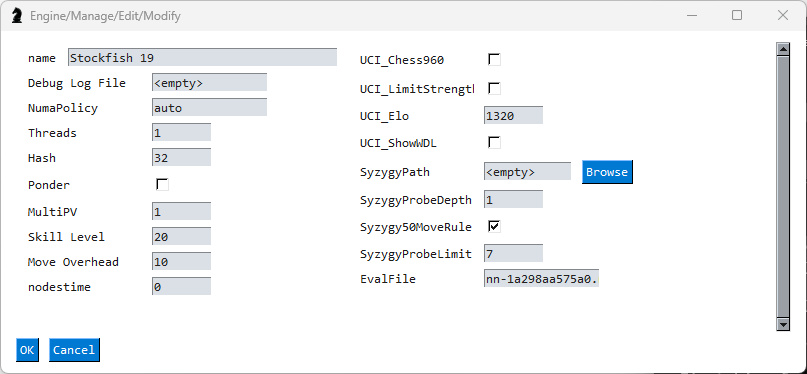
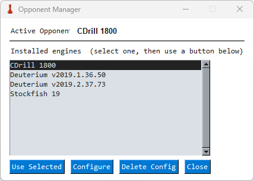
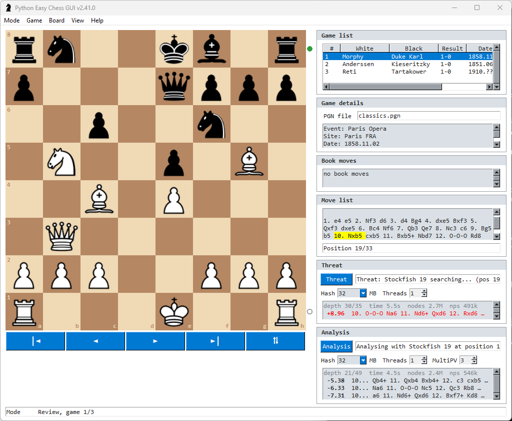
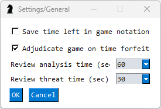
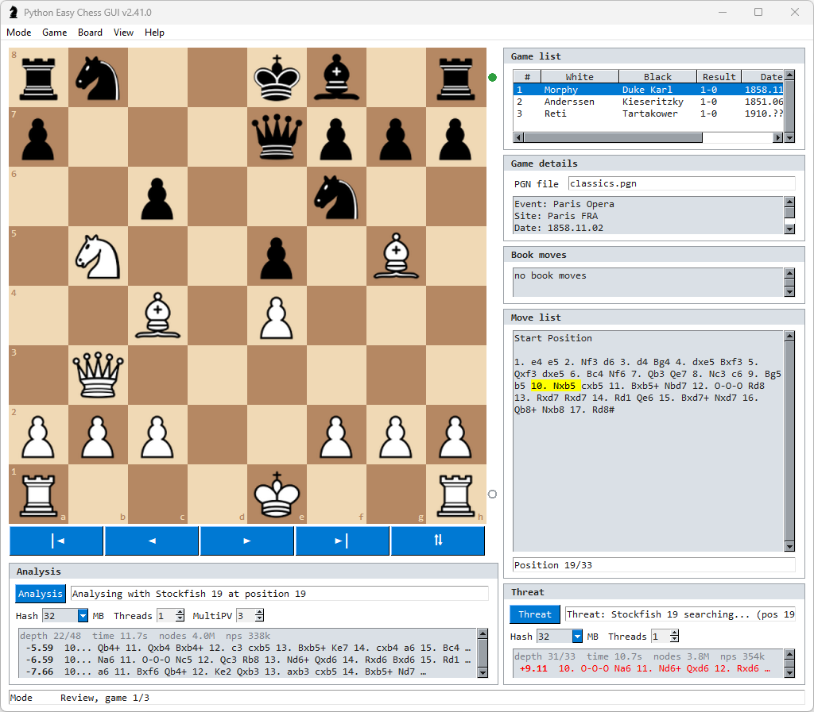

# Python Easy Chess GUI
A chess GUI written in Python with [FreeSimpleGUI](https://github.com/spyoungtech/FreeSimpleGUI) and [python-chess](https://github.com/niklasf/python-chess). Play against any UCI chess engine, then replay and analyse your games with engine analysis, threat detection and automatic annotation.



**Contents**
* [A. Features](#a-features)
* [B. Requirements](#b-requirements)
* [C. Installation](#c-installation)
* [D. How to use](#d-how-to-use)
* [E. Credits](#e-credits)

### A. Features
* **Two modes.** *Play* a game against an engine, or *Review* a saved game.
* **Any UCI engine.** Install your own engines and give each job its own engine: opponent, adviser, analysis and threat.
* **Play mode.** Clocks with time control, opening books, an engine adviser, automatic saving of every game, and saving to repertoire files.
* **Review mode.** Game list, move list with variations and comments, multi-line engine analysis, threat detection, and Auto-Analyze, which annotates a whole game.
* **Edit and annotate.** In Review mode enter moves and variations on the board, add comments and annotations such as `!` and `??` (shown in color), and save the game to a PGN file.
* **Engine settings where you use them.** Hash, Threads and MultiPV are set right in the Analysis and Threat panels.
* **A layout you arrange.** Every panel can be dragged to the left, to the right or below the board and resized. The arrangement is saved for each mode.
* **Board options.** Six board sizes, flip at any time, square colors and GUI themes.
* **Windows, Linux and macOS.**

### B. Requirements
To run from the Python source:
* Python 3.8 and up
* [python-chess](https://github.com/niklasf/python-chess) (the `chess` package)
* [FreeSimpleGUI](https://github.com/spyoungtech/FreeSimpleGUI) 5.0.0 and up

`requirements.txt` lists the versions the app is developed with. No other packages are needed.

Or download the [executable file](https://github.com/fsmosca/Python-Easy-Chess-GUI/releases), which comes with the books and images.

### C. Installation
#### From the source code
1. Install [Python 3](https://www.python.org/downloads/).
2. Download this repository, including the `Images`, `Icon`, `Engines` and `Book` folders.
3. Install the two packages:
   ```
   pip install -r requirements.txt
   ```
4. Start the GUI from the repository folder:
   ```
   python python_easy_chess_gui.py
   ```
   On Windows you can also double-click `run_pecg.bat`.

Run it from the repository folder: the images, books and engines are found relative to it.

#### From the exe
Download the exe file from the [releases](https://github.com/fsmosca/Python-Easy-Chess-GUI/releases) page and run it.

#### Engines
A few engines come in the `Engines` folder and are installed on the first start. To add your favorite UCI engine, such as Stockfish, see [D.3 Engines](#d3-engines).

On Linux, give the engine permission to run first: `chmod +x your_engine`.

### D. How to use

This is the detailed manual. Inside the app the **Help** menu gives a short version of each topic; see [D.10 Help menu](#d10-help-menu).

| | Section | What it covers |
|---|---|---|
| D.1 | [Modes and menus](#d1-modes-and-menus) | Play and Review, and what each menu offers |
| D.2 | [Play a game](#d2-play-a-game) | Moving, playing as Black, clocks, saving, adviser and book moves |
| D.3 | [Engines](#d3-engines) | Install an engine, set its options, choose the engine for each job |
| D.4 | [Review mode](#d4-review-mode) | Open games, navigate, enter and annotate moves, save, analysis, threat, Auto-Analyze |
| D.5 | [Settings](#d5-settings) | The Settings menu |
| D.6 | [Opening books](#d6-opening-books) | The opponent's book and the book panels |
| D.7 | [Panels and layout](#d7-panels-and-layout) | Move and resize the panels |
| D.8 | [Board appearance](#d8-board-appearance) | Flip, size, colors, theme |
| D.9 | [Files the app writes](#d9-files-the-app-writes) | Games, settings and the log |
| D.10 | [Help menu](#d10-help-menu) | The help inside the app |

---

#### D.1 Modes and menus
The GUI opens in **Play** mode, ready to play. There are two modes:
* **Play** — play a game against the opponent engine.
* **Review** — step through a saved game with engine analysis and threat, or enter and annotate a game yourself.

##### Switching modes
* `Mode → Review` enters Review mode (before a game starts).
* `Mode → Play` goes back to Play mode.

##### Before and during a game
In Play mode all setup (engines, time, book, settings, board colors) is done from the menubar **before a game starts**. The setup menu items are grayed out while a game is running and come back after `Game → New` or when the game ends.

##### What each menu offers

| Menu | Play mode | Review mode |
|---|---|---|
| **Mode** | Review | Play |
| **Game** | New, Paste FEN, Resign, User Wins, User Draws, Save | New Game, Select Game, Save Game, Game Details, Auto-Analyze Game, Cancel Analysis |
| **Engine** | Go, Move Now, Set Engine Opponent / Adviser / Analysis / Threat, Set Depth, Manage | — |
| **Board** | Flip, Size, Color, Theme | Flip, Size |
| **View** | Arrangements, Move Panel, Reset Layout | Arrangements, Move Panel, Reset Layout |
| **Settings** | General, Time, Set Book, User Name, PGN | — |
| **Help** | Help topics for Play and Review, About | Help topics for Review, About |

---

#### D.2 Play a game
##### Make a move
* **As white:** click the piece and then the destination square, or drag the piece. Your first move starts the game and the clocks.
* **As black:** press `Engine → Go` before making a move. The engine takes White and moves first, and the board flips so Black is at the bottom. `Game → New` returns you to White.
* **Whose turn:** two dots beside the board, level with each player's back rank. The green one marks the side to move.

##### Control the game
* **Force the engine to move now:** `Engine → Move Now`.
* **Start a new game:** `Game → New`.
* **End a game manually:** `Game → Resign`, `User Wins` or `User Draws`.
* **Paste a position (FEN):** `Game → Paste FEN` (before a game starts). If the side to move is not yours, press `Engine → Go`.

##### Clocks
* `Settings → Time → User` sets your clock and `Settings → Time → Engine` the opponent's, before a game starts.
* The Players panel shows each side's remaining time and the time spent on the current move.

##### Save games
* Every game is saved automatically to `pecg_auto_save_games.pgn`.
* During a game `Game → Save` also offers *Save to My Games* and *Save to White / Black Repertoire*.

##### Get help during a game
These are switched on by right-clicking a label in a panel:
* **Adviser:** right-click the **Adviser** label in the Engine panel and press **Start** to get a suggested move and score from the adviser engine.
* **Opening book moves:** right-click *BOOK 1* or *BOOK 2* in the Opening books panel → **Show** / **Hide**.
* **Engine search info:** right-click *Opponent Search Info* in the Engine panel → **Show** / **Hide**.

---

#### D.3 Engines
Only **UCI** engines are supported. All engine actions are in the **Engine** menu of Play mode and are available **before a game starts**.

##### Install an engine



1. `Engine → Manage → Install` and press **Add**.
2. Press **Browse** and locate the engine executable.
3. Press **Get Id Name** to read the engine's name (or type a name), then **OK**.

On Linux make the file executable first: `chmod +x your_engine`.

##### Set the engine's options



* `Engine → Manage → Edit`, select the engine and press **Modify** to set Hash, Threads and its other options. This is recommended right after installing.
* `Engine → Manage → Delete` removes an engine.

##### Choose the engine for each job



There are four jobs, each with its own engine:

| Menu item | Job |
|---|---|
| `Engine → Set Engine Opponent` | The engine you play against. |
| `Engine → Set Engine Adviser` | Suggests a move during a game (right-click **Adviser** → **Start**). Its thinking time is set here too. |
| `Engine → Set Engine Analysis` | Used by the **Analysis** button in Review mode. |
| `Engine → Set Engine Threat` | Used by the **Threat** button in Review mode. |

In the manager that opens:
* **Use Selected** makes the selected engine do this job.
* **Configure** gives that engine different options for this job only, for example more Hash for analysis than for play. Engines with such options are marked *(configured)*.
* **Delete Config** removes those options again.

##### Limit the search depth
`Engine → Set Depth` caps the depth of the playing and adviser engines. Review analysis and threat are limited by **time** instead (see [D.5 Settings](#d5-settings)).

---

#### D.4 Review mode



##### Open a PGN file
1. `Mode → Review`, then `Game → Select Game`.
2. Choose a PGN file, or pick one from the **Recent** drop-down.
3. Select a game and press **OK**, or double-click it.

Click a column heading (White, Black, Result, Date, Event) to sort the games. The file opened last is loaded again the next time.

##### Switch games
The **Game list** panel shows the games of the PGN file.
* Click a game to put it on the board, or use the **Up / Down** keys in the list.
* Click a column heading to sort, and again to reverse the order.
* Analysis and Threat, if they are on, follow the board to the new game.

##### Move through the game
* The arrow buttons under the board: first, previous, next, last.
* The **Left / Right** arrow keys, and **Home / End** for the first and last position.
* Click a move in the move list to jump to that position.
* The last button of the bar, or `Board → Flip`, flips the board.
* The Book moves panel lists the opening book moves of the current position.

##### Read the move list
* The **main line** of the game is bold. A variation is in brackets on its own line, indented; a variation inside a variation is indented further.
* The current move is marked yellow (green in a variation, whose line gets a light background).
* Comments are green, without the braces `{ }` they have in the PGN file.
* A move with a move annotation is colored:

| Annotation | Meaning | Color |
|---|---|---|
| `??` | Blunder | Red |
| `?` | Mistake | Light red |
| `?!` | Dubious move | Orange |
| `!?` | Interesting move | Purple |
| `!` | Good move | Light blue |
| `!!` | Brilliant move | Blue |

##### Enter moves and variations
Move a piece on the Review board as in Play mode: click it and then its square, or drag it. No game has to be loaded first: `Game → New Game` gives an empty game to enter from the start position (Review mode also starts with one when no PGN file is open).

| Where you move | What happens |
|---|---|
| After the last move of a line | The move is added to that line. |
| A move the game already has there | You go to that move. |
| Any other move | A new variation starts at that point. |

A variation can have variations of its own, to any depth.

**Right-click a move** in the move list for the commands below. A right-click elsewhere in the move list gives the same menu for the current move.

| Command | What it does |
|---|---|
| **Promote Variation** | Moves the variation of the move one place up among the alternatives. From the first place it becomes the line it left, and that line becomes the variation. |
| **Demote Variation** | Moves it one place down. On the main line, the nearest alternative becomes the main line. |
| **Make Main Line** | Makes the move, and the moves leading to it, the main line of the game. |
| **Delete Variation** | Deletes the whole variation the move is in. |
| **Delete This Move and the Rest** | Deletes the move and everything after it. |
| **Delete the Moves After** | Keeps the move and deletes everything after it. |

Deleting more than one move asks first. The game cannot be changed while Auto-Analyze is running.

##### Comments and annotations
In the same right-click menu:
* **Comment...** — the text after the move. The first move of a variation can also have a comment before it. At *Start Position* it is the comment before the first move. Press **Enter** or **OK** to keep it.
* **Move Annotation** — `!` `?` `!!` `??` `!?` `?!` or `□` (only move). A move has one; **None** removes it.
* **Position Annotation** — `=` (equal), `∞` (unclear), `+=` `=+` (slightly better for White / Black), `+/-` `-/+` (better), `+-` `-+` (winning). **None** removes it.

Annotations are saved in the PGN file as the standard `$` codes, so other chess programs read them.

##### Save a game
* `Game → Save Game` (or **Ctrl+S**, or **Save Game...** in the right-click menu) asks for the **folder** and the **file name** of a PGN file.
* The game is **added at the end** of that file. The games already in the file are kept; a new name makes a new file.
* The file chosen last is offered the next time.
* When the game is added to the file shown in the Game list, the list shows it as the last game.
* `Game → Game Details` sets the event, site, date, round, players and result that are saved with the game.
* The status bar shows *changed, not saved* until the game is saved. You are asked whether to save before a changed game is replaced by another one, and before you leave Review mode or close the window.

##### Analysis and Threat
* **Analysis:** press the **Analysis** button (or **Alt+A**) to evaluate the current position. The search stops after the *analysis time* (default 60s) and restarts automatically when you change position.
* **Threat:** press the **Threat** button (or **Alt+T**) to see what the opponent would play if the side to move passed (a null move). It is unavailable when the side to move is in check, and stops after the *threat time* (default 30s).

Both run their engines for at most their configured time and then go idle, so they do not keep the CPU busy after a position has been evaluated.

##### Read the output
* Each box starts with the search figures: depth and selective depth, time, nodes, nodes per second.
* Then comes one line per variation: the score, followed by the moves with move numbers.
* The score is in pawns for the side to move. For Threat that is the opponent, who moves after the pass.
* `#3` means the side to move mates in 3, and `-#3` that it is mated in 3.
* A line is as long as the panel is wide (a cut line ends with `…`). Widen the panel or put it under the board to see more moves.

##### Hash, Threads and MultiPV
* Set them in the Analysis panel. Hash and Threads are also in the Threat panel.
* MultiPV is the number of lines shown, 1 to 10.
* The values are saved, and a running search restarts with the new value.
* A setting the engine does not have is greyed out.

##### Auto-Analyze Game
`Game → Auto-Analyze Game` annotates the moves of the main line with the engine and time per move you choose.

**Which moves.** *Start move* and *End move* in the dialog are move numbers; both White's and Black's move of each number in between are analysed. They start at **4** (the first three moves, the opening, are skipped) and **1000** (to the end of the game), every time the dialog opens. Type a number or use the arrows. *Game has moves* shows the first and last move number of the game. Moves outside the range are left as they are.

**Score.** Each move gets an evaluation comment, from the point of view of the side that played it (positive is good for that side).

A mate is counted from the position after the move, since the comment comes after it:
* `19. Qc7# Mate` — the move mates.
* `18. Rd8+ Mate in 1` — one more move mates.
* `18... Kh8 Mated in 1` — the side that moved is mated on the opponent's next move.

**Bad moves** are marked by what the move loses against the engine's best move, and by what is left after it:

| Mark | The move loses | After the move |
|---|---|---|
| `?!` | 1.00 pawn or more | — |
| `?` | 2.00 pawns or more | the side is not losing |
| `??` | 2.00 pawns or more | the side is losing (−3.00 or worse) |

No mark is given while the side is still winning (+3.00 or better) after the move, or was already losing before it. So a move that turns +6.00 into 0.00 is a mistake `?`, not a blunder: the win is gone but the game is not lost.

**Better is.** The engine's line is added as a *Better is* variation when:
* its move is better than the game move by 0.25 or more, or by 0.10 or more when the engine's score is within 0.50 of equal, and
* the engine's score is within 10.00 of equal (beyond that the position is decided either way).

The variation is the line the engine gave, in full. The move list shows it as `( Better is 9... Qe6 +1.53 10. Re1 Nf6 — Stockfish 17 )`, with *Better is*, the score and the engine name in the color of comments (in the PGN file they are comments, in braces). The score after the first move is the engine's score of the line, from the same side's point of view as the game move. The dash and the name after the last move tell which engine the line is from.

**Missed wins.** Beyond 10.00 the rule above adds nothing, but a win that was missed is still shown. When the engine's score is above +10.00 and the game move is worse by 2.00 or more, the engine's line is added with a mark on its first move:

| Mark | The engine's move |
|---|---|
| `!!` | mates in 10 moves or less |
| `!` | any other win (a longer mate, or a score above +10.00) |

For example `( Better is 4. Qxf7#!! Mate — Stockfish 17 )`. A move that mates more slowly than the engine's, or wins slightly less, is not a missed win.

**How it searches.** Each position is searched for the two best lines. If the game move starts one of them, that line's score is its score; otherwise the position after the game move is searched too.

**What the game already has.** Comments, annotations and variations of the game are kept, and the analysis is added to them:
* a move's comment keeps its text and gets the score at the end;
* a move that already has a move annotation keeps it;
* your variations stay beside the engine's.

If the game has any of these, the dialog shows how many and offers **Remove them first** for a clean start. The choice is asked every time and is not remembered.

**Analysing again.** With the same engine, its scores and its own lines are replaced. With another engine, the scores are replaced and its lines are added beside those of the first, each ending with its engine's name.

The annotated game is appended to `pecg_analyzed_games.pgn` and replaces the game on the board. `Game → Cancel Analysis` stops early.

---

#### D.5 Settings
The **Settings** menu is in Play mode and is available before a game starts. All values are saved to `pecg_settings.json` and restored on the next startup.

##### General



`Settings → General`:
* **Save time left in game notation** — adds `[%clk h:mm:ss]` move comments, shown in the move list and saved to the PGN.
* **Adjudicate game on time forfeit** — ends the game when a player runs out of time.
* **Review analysis time (sec)** — time cap for the Review **Analysis** engine. Default **60**, range 1–3600.
* **Review threat time (sec)** — time cap for the Review **Threat** engine. Default **30**, range 1–3600.

##### The other items
* `Settings → Time → User` / `Engine` — the time control of each side.
* `Settings → Set Book` — the opponent's opening book (see [D.6 Opening books](#d6-opening-books)).
* `Settings → User Name` — your name, as shown in the Players panel and saved in the games.
* `Settings → PGN → Delete Player` — lists the players of a PGN file and deletes the games of the one you select.

---

#### D.6 Opening books
* **Opponent book:** `Settings → Set Book` (before a game starts) sets how the opponent uses its polyglot book: whether it is used, up to which ply, and best move or random. The book is `pecg_book.bin` in the `Book` folder. To change it, build your own polyglot book, name it `pecg_book.bin` and replace the default.
* **Book panels:** *BOOK 1* (computer games) and *BOOK 2* (human games) show the book moves of the current position in Play mode; right-click their label → **Show** / **Hide**. Review mode shows them in the Book moves panel.

---

#### D.7 Panels and layout
Both windows are made of panels around the board. Each mode keeps its own arrangement, and all of this works at any time, including during a game or while an analysis is running.



##### The panels
* **Play:** Players, Move list, Comment, Opening books and Engine.
* **Review:** Game list, Game details, Book moves, Move list, Threat and Analysis. The bar of buttons under the board (first, previous, next, last and flip) is part of the board: it stays under it, and panels placed below the board come under it.

##### Move a panel
* Drag it by its title bar to the left of the board, to the right, or below it. A green bar shows where it will land.
* `View → Move Panel` does the same from the menu.
* **Ready-made arrangements:** `View → Board Left`, `Board Centre` or `Board Right`, plus `Engine Below Board` in Play and `Analysis Below Board` in Review.

##### Resize
* Drag the divider between two panels, or between the board and the panels beside it. The board takes the largest size that fits.
* Beside the board, spare height goes to the Move list, or to the last panel of a column without it.

##### Panels under the board
* **Several panels:** drop a panel on the top or bottom edge of a panel that is already there to put it above or below it (for example board, Analysis, Threat), or on its middle to put it beside it. `View → Move Panel → Below Board` adds it as a new row at the bottom.
* **Their height:** drag the divider between the board and those panels up or down. The board keeps its size and the window changes height instead. In a maximized window the divider stays where you drop it, and the board takes the largest size that fits above it.

##### Saved layout
The arrangement, the sizes and the window size are saved in `pecg_settings.json` and restored at the next start. `View → Reset Layout` goes back to the default.

---

#### D.8 Board appearance
* **Flip:** `Board → Flip`, at any time — including while a game is running or the engine is thinking. The game is not affected.
* **Size:** `Board → Size` picks a board size — Small (360), Medium (480), Large (600), X-Large (720), XX-Large (840) or Huge (960) pixels — at any time, like Flip. On first start the largest board that fits the screen is chosen automatically; the size is saved and restored.
* **Resizable windows:** the Play and Review windows can be maximized or drag-resized. The board switches to the largest of these sizes that fits and the side panels absorb the remaining space.
* **Colors / theme:** `Board → Color` for square colors and `Board → Theme` for the overall GUI theme (in Play mode, before a game starts).

---

#### D.9 Files the app writes
All of them are written to the folder the app is started from.

| File | Contents |
|---|---|
| `pecg_auto_save_games.pgn` | Every game played. |
| `pecg_analyzed_games.pgn` | Games annotated by Review mode's Auto-Analyze. |
| `pecg_engines.json` | Installed engines and their options. |
| `pecg_user.json` | User name(s). |
| `pecg_settings.json` | Settings: the General values, the engine chosen for each job and its options, board size, panel layouts and recent PGN files. |
| `pecg_log.txt` | Log file, started fresh on every run. Look here first when something goes wrong. |

---

#### D.10 Help menu
The **Help** menu gives a short version of this manual inside the app. Each item opens a small window on one topic. The menu follows the mode: Play mode shows every group, Review mode leaves out the Play group.

| Help item | Topics |
|---|---|
| **Getting Started** | The first steps: install an engine, choose the opponent, start a game. |
| **Mouse and Keyboard** | Every mouse action and keyboard shortcut of both modes on one page. |
| **Play** | Play a Game, Play as Black, Paste FEN, Adviser and Book Moves, Save and Repertoire, Time Control. |
| **Engine** | Install / Manage, Engine for Each Job, Set Opponent, Adviser, Analysis, Threat, Search Depth. |
| **Review** | Open a Game, Navigate Moves, Enter Moves and Variations, Comments and Annotations, Save a Game, Analysis and Threat, Auto-Analyze Game. |
| **Board and Layout** | Flip, Size, Panels and Layout, Colors and Themes. |
| **Settings** | The items of the Settings menu. |
| **Files the App Writes** | The files listed in D.9. |
| **About** | The version, the license and the address of this page. |

### E. Credits
* [FreeSimpleGUI](https://github.com/spyoungtech/FreeSimpleGUI) — the GUI toolkit.
* [python-chess](https://github.com/niklasf/python-chess) — chess rules, PGN, opening books and UCI engine communication.
* [PySimpleGUI](https://github.com/PySimpleGUI/PySimpleGUI) — this program started from its [demo chess against AI](https://github.com/PySimpleGUI/PySimpleGUI/tree/master/Chess).
* [Claude](https://claude.com/claude) by [Anthropic](https://www.anthropic.com/) — used to write code and improve the GUI.
* [The Week in Chess](https://theweekinchess.com/) — games for the opening books.
* [PyInstaller](https://github.com/pyinstaller/pyinstaller) — builds the executable.
* [pgn-extract](https://www.cs.kent.ac.uk/people/staff/djb/pgn-extract/) — PGN processing.
